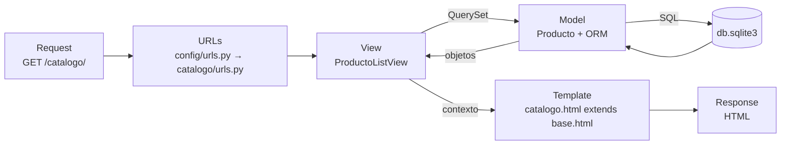
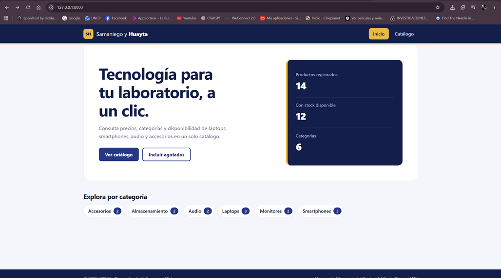
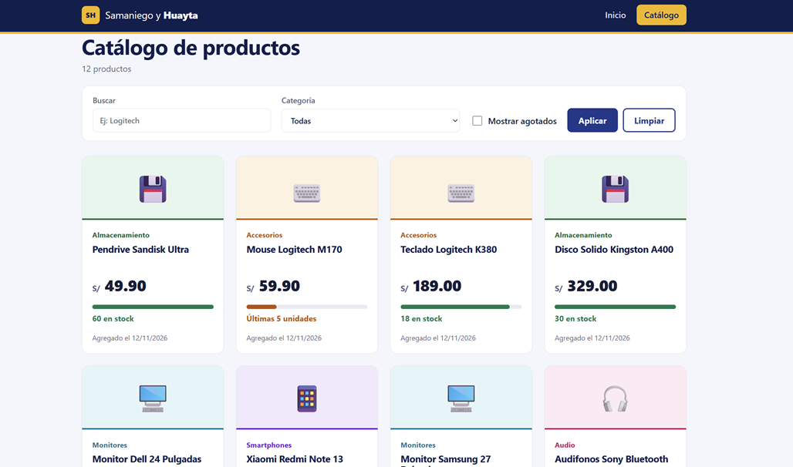
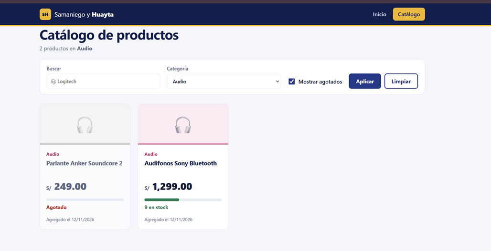
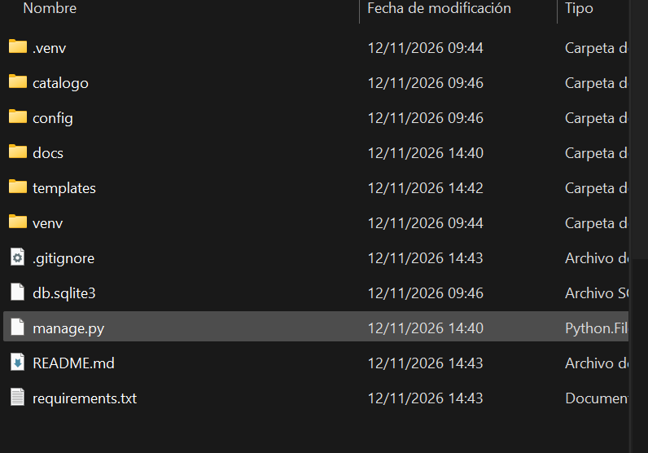
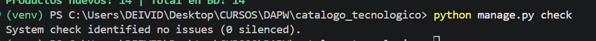

# Catálogo de Productos Tecnológicos

**Universidad Nacional del Centro del Perú** · Facultad de Ingeniería de Sistemas
**Asignatura:** Desarrollo de Aplicaciones Web (IS093A) · **Guía Práctica Grupal – Semana 11**
**Fecha:** 12/11/2026

## Integrantes y roles

| Integrante | Roles asumidos |
|------------|----------------|
| Samaniego Quispe Deivid Willian | Arquitecto Django · Ingeniero de Plantillas |
| Huayta Hinojosa Henry Hans | Desarrollador de Vistas · QA & ORM Validator |

## Descripción

Aplicación web hecha con Django (arquitectura **MTV**) que muestra un catálogo de productos tecnológicos con búsqueda, filtro por categoría, indicador de stock y estado "Agotado".

- `/` → **FBV** `home`: bienvenida con resumen del catálogo.
- `/catalogo/` → **CBV** `ProductoListView` (ListView): listado con filtros.

## Estructura de carpetas

```
catalogo_tecnologico/
├── manage.py
├── config/                 # Proyecto: settings.py, urls.py, wsgi.py
├── catalogo/               # App
│   ├── migrations/
│   ├── management/commands/cargar_productos.py
│   ├── static/catalogo/css/estilos.css
│   ├── admin.py  models.py  urls.py  views.py  tests.py
├── templates/              # base.html, home.html, catalogo.html, 404.html
├── docs/capturas/          # Capturas para este README
├── requirements.txt
├── .gitignore
└── README.md
```

## Cómo ejecutarlo

```bash
python -m venv venv
venv\Scripts\activate            # Windows   (Linux/Mac: source venv/bin/activate)
pip install -r requirements.txt
python manage.py migrate
python manage.py cargar_productos   # carga 14 productos de ejemplo
python manage.py check
python manage.py runserver
```

Abrir: http://127.0.0.1:8000/ y http://127.0.0.1:8000/catalogo/

Pruebas automáticas: `python manage.py test`

## Diagrama MTV (flujo de una petición)



1. El navegador envía el **Request** `GET /catalogo/`.
2. `config/urls.py` delega con `include()` a `catalogo/urls.py`, que resuelve la ruta con `name='catalogo'`.
3. La **View** (`ProductoListView`) construye el QuerySet usando el **Model** `Producto`.
4. El ORM traduce el QuerySet a SQL y consulta la base de datos.
5. La vista entrega el contexto (`productos`, `categorias`, ...) al **Template** `catalogo.html`, que hereda de `base.html`.
6. Django devuelve el **Response** (HTML) al navegador.

## QuerySets utilizados y lazy evaluation

**QuerySet 1 – productos con stock, ordenados por precio** (`ProductoListView.get_queryset`):

```python
Producto.objects.filter(stock__gt=0).order_by("precio")
```

**QuerySet 2 – filtro por categoría (sin distinguir mayúsculas)**, encadenado sobre el anterior:

```python
qs.filter(categoria__iexact="Laptops")
```

> Además, `home` usa `Producto.objects.count()` y `Producto.objects.filter(stock__gt=0).count()` para el resumen.

### Lazy evaluation

Los QuerySets de Django son **perezosos**: construir o encadenar `filter()` y `order_by()` **no ejecuta ninguna consulta**; solo se arma la consulta. La base de datos se consulta cuando el QuerySet se **evalúa**: al iterarlo (`for` / ``), con `list()`, `len()`, `bool()`, al segmentarlo con paso, etc. Además, el resultado queda en caché dentro del QuerySet, así que evaluarlo otra vez no repite la consulta.

En este proyecto, en `get_queryset()` se encadenan hasta cuatro filtros (stock, agotados, categoría, búsqueda) y **solo se ejecuta una consulta SQL** cuando el template recorre ``. Esto evita consultas innecesarias.

## Conceptos aplicados

| Requisito | Dónde se ve |
|-----------|-------------|
| Proyecto + app separada | `config/` y `catalogo/` |
| `name` y `` | `catalogo/urls.py`, `templates/base.html`, `templates/home.html` |
| Herencia de plantillas | `` + `` |
| Tags `for` / `if` / `empty` | `templates/catalogo.html` |
| Filtros | `title`, `slugify`, `pluralize`, `date`, `floatformat`, `intcomma`, `urlencode` |
| Condicional de stock | Agotado / Últimas N unidades / N en stock |
| Manejo de errores | `home` captura `OperationalError` si falta `migrate`; `404.html` |
| Seguridad | `SECRET_KEY` y `DEBUG` por variables de entorno; `.gitignore` excluye `db.sqlite3`, `__pycache__`, `.env` |

## Capturas

### 1. Página de inicio (`/`)


### 2. Catálogo renderizado (`/catalogo/`)


### 3. Catálogo con agotados y filtro por categoría


### 4. Estructura de carpetas


### 5. Validación técnica (`check`, `migrate`, `runserver`)

